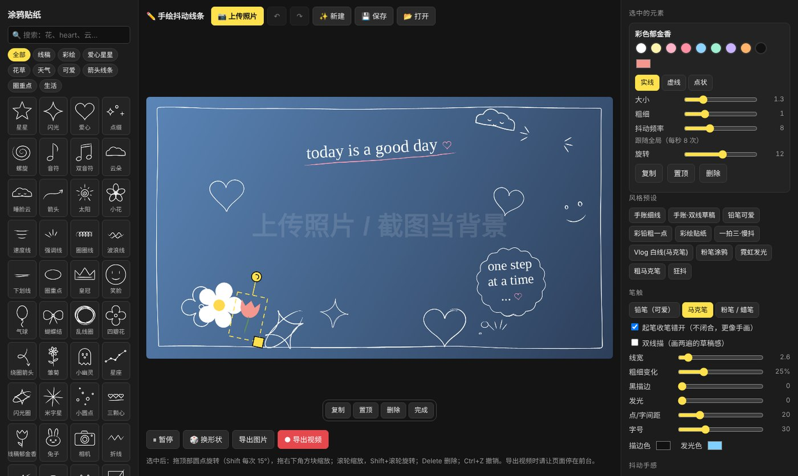
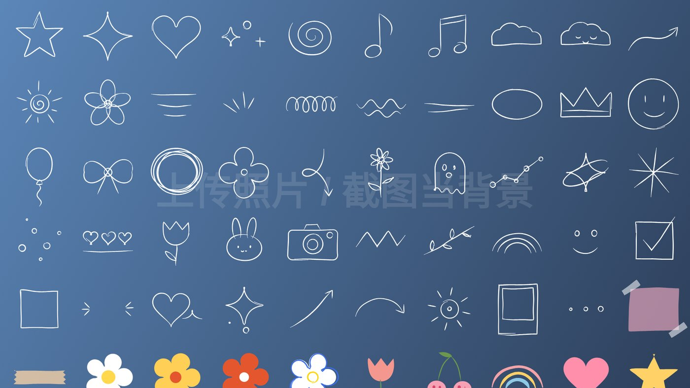
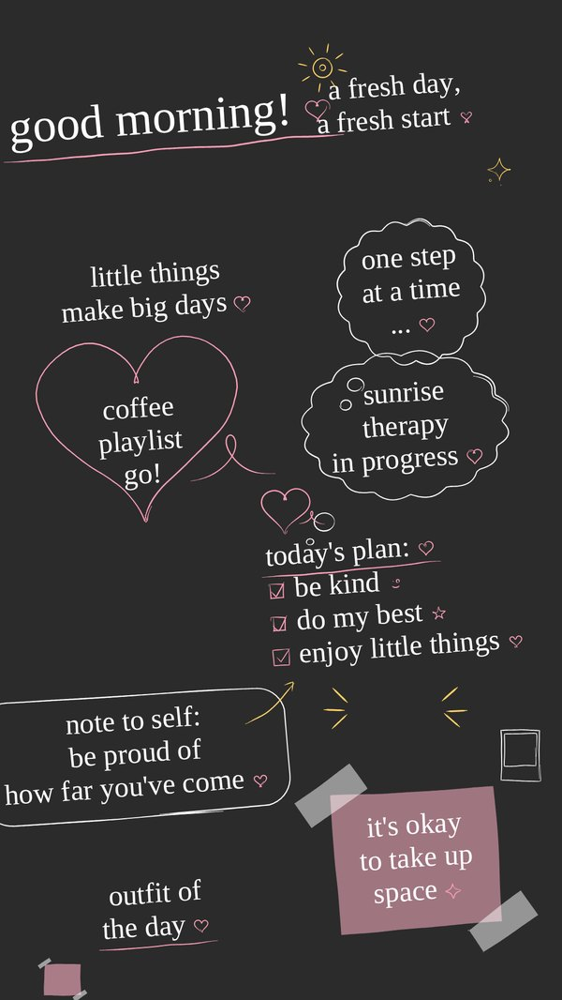
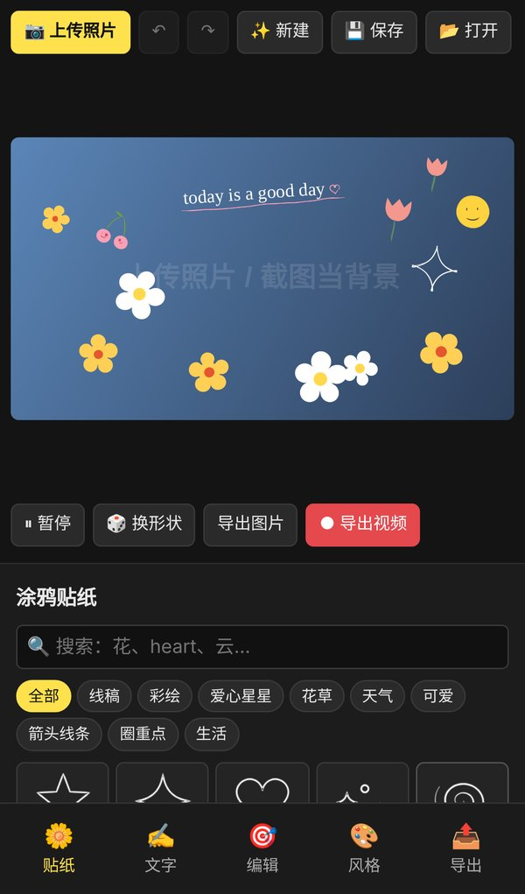

 手绘抖动线条 · 手账涂鸦视频生成器

不用 PR / AE，打开网页就能给照片加会抖动的手绘涂鸦，一键导出 Vlog 视频。

https://meetnatelee-debug.github.io/wiggle-doodle/

## 三步做一段涂鸦视频

1. **上传照片**：照片只在你自己的浏览器里处理，不会上传到任何服务器。
2. **选一个风格**：手账白线、铅笔可爱、彩绘贴纸、双线草稿、粉笔涂鸦、Vlog 白框。
3. **微调 & 导出**：拖动、旋转、换颜色，最后点「导出视频」得到 MP4，或者「导出图片」得到 PNG。

## 有什么

| | |
|---|---|
| 🌼 **50+ 手绘贴纸** | 星星、爱心、闪光、云朵、小花、樱桃、彩虹、兔子、相机、箭头、勾选框……分类 + 搜索 |
| ✍️ **手写字** | 中英文手写字体，14 个文字模板，♡ ☆ ✦ ☺ 自动变成手绘小图标，`[x]` 变成勾选框 |
| 💬 **文字框** | 椭圆 / 云朵 / 圆角对话框、爱心框、便签纸 |
| 🎨 **笔触** | 手账细线、彩铅颗粒、粉笔、马克笔 + 黑描边、霓虹发光、双线草稿 |
| 〰️ **抖动手感** | 抖动幅度、频率、"一拍三" 循环，每个贴纸还能单独调大小 / 粗细 / 抖动频率 |
| ✏️ **画笔** | 自由画，沿着人物描一圈会抖的白边 |
| 📐 **画幅** | 16:9 横屏、9:16 竖屏、1:1，最高 4K |
| 💾 **项目** | 自动保存进度，可保存 / 打开项目文件，支持撤销重做 |

## 放进剪辑软件

- **直接发视频**：背景选「照片背景」导出即可。
- **叠加到你的视频上**：背景选「绿幕」导出，PR 里用「超级键」、剪映里用「色度抠图」抠掉绿色。

## 小贴士

- 电脑上：拖顶部圆点旋转，拖右下角方块缩放；滚轮缩放，Shift + 滚轮旋转；Delete 删除；Ctrl + Z 撤销。
- 手机上：双指捏合可以缩放、旋转选中的贴纸；底部标签切换贴纸 / 文字 / 编辑 / 风格 / 导出。
- 导出视频是实时录制的，录制时请让页面停在前台。推荐使用 Chrome、Edge 或 Safari。

## 技术说明

整个工具就是一个 `index.html` 文件：Canvas 逐帧绘制，浏览器自带的 MediaRecorder 录制视频。不需要安装，不需要服务器，下载下来双击也能离线使用（手写字体需要联网加载）。

## License

[MIT](LICENSE)，欢迎使用、修改、分享，保留署名即可。
